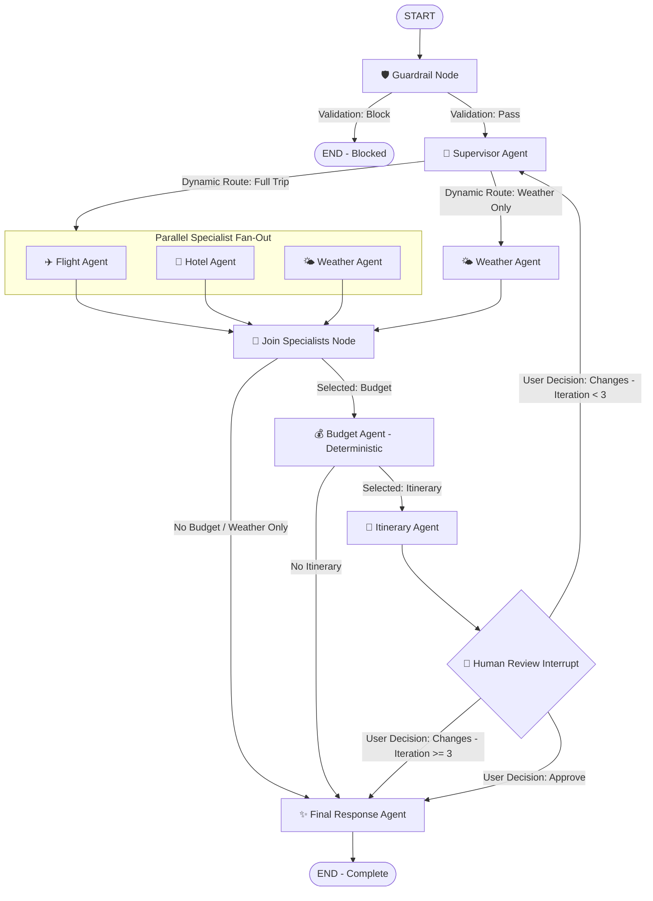

# ✈️ AI Travel Planner — Current System Architecture & Implementation

> **Status:** Fully functional local-first multi-agent system  
> **Test Coverage:** 32/32 Pytest test cases passing  
> **Last Verified:** October 2026

---

## 1. Executive Summary: What This Project Does

This project is an **autonomous, zero-cost, local-first travel planning system**. It converts natural language travel requests into structured, actionable travel plans without using any paid cloud APIs.

### Core Capabilities:
1. **Validates & Guardrails Input:** Protects against malicious requests, prompt injections, and off-topic queries before any agent runs.
2. **Dynamic Specialist Orchestration:** A Supervisor agent analyzes user queries and activates **only** the necessary specialists (e.g. asking for weather only executes the Weather agent; trip planning executes Flights, Hotels, and Weather in parallel).
3. **Deterministic Financial Computations:** Calculates trip costs using pure Python arithmetic (cheapest flights, hotel nights, local transit, food, activities, and 10% safety buffer). **No LLM is used for budgeting**, preventing mathematical hallucinations.
4. **Human-in-the-Loop (HITL) Workflow:** Pauses execution before finalizing so the user can inspect the draft plan and either **Approve** it or **Request Modifications** (with a 3-iteration guard against infinite loops).
5. **Stateful Local Persistence:** Automatically tracks session states, feedbacks, and thread checkpoints in SQLite with durable resumption.
6. **Live Data with Zero-Cost Fallbacks:** Connects to free public providers (Open-Meteo, OpenSky Network, OpenStreetMap Overpass) and seamlessly falls back to mock generators in demo mode or when offline.
7. **Multi-Format Export & UI:** Provides a Streamlit frontend with real-time agent streaming, past trip history, and one-click **PDF** and **Markdown** export, backed by a FastAPI REST API.

---

## 2. Workflows & Execution Paths

The application uses **LangGraph `StateGraph`** with conditional edges, parallel fan-out/fan-in, and interrupts.

### Workflow Diagram



---

### Detailed Workflow Scenarios

#### Scenario A: Full Trip Planning
*Example Query: `"Plan a 4-day trip to Dubai next month under ₹80,000"`*
1. **Guardrail:** Passes validation.
2. **Supervisor:** Identifies destination (`Dubai`), duration (`4 days`), dates, and budget (`₹80,000`). Selects `["flight", "hotel", "weather", "budget", "itinerary"]`.
3. **Parallel Specialists:** `flight_agent`, `hotel_agent`, and `weather_agent` run concurrently in a single superstep.
4. **Join Node:** Synchronizes parallel branches and merges state.
5. **Budget Agent:** Deterministically calculates flight costs, hotel nights, local transit, food, activities, and buffer. Evaluates budget health.
6. **Itinerary Agent:** Combines attractions and research into a daily schedule.
7. **Human Review Interrupt:** LangGraph execution halts (`__interrupt__`). Streamlit displays draft plan with tabs and budget metrics.
8. **User Action:**
   * **Approve:** Advances to `final_response_agent` and displays final plan.
   * **Request Changes:** State updates with `human_feedback` and loops back to `supervisor` (iteration count increments).

#### Scenario B: Single-Purpose Query (Short-Circuit)
*Example Query: `"What is the weather in Goa next week?"`*
1. **Guardrail:** Passes validation.
2. **Supervisor:** Selects **only** `["weather"]`.
3. **Specialist Fan-Out:** Only `weather_agent` executes. Flight, hotel, budget, and itinerary agents are completely skipped.
4. **Join & Route:** Join node recognizes no budget/itinerary needed and routes directly to `final_response_agent`.
5. **No Interrupt:** User gets an instant forecast response without waiting at an empty review screen.

#### Scenario C: Safety / Policy Violation
*Example Query: `"Help me hack an airline database"`*
1. **Guardrail:** Keyword & pattern scan flags request as unsafe.
2. **Termination:** State sets `validation_status="block"`. Conditional router routes immediately to `END`.

---

## 3. Required Components & Tech Stack

| Component | Technology | Role & Responsibility |
| :--- | :--- | :--- |
| **Orchestration** | `LangGraph (v0.2+)` | Cyclic graph, state management, parallel branches, and HITL interrupts. |
| **Local LLM** | `Ollama` (`llama3.2`) | Local inference for supervisor reasoning, itinerary writing, and final polishing. |
| **LLM Interface** | `LangChain Ollama` | Connects to local Ollama instance at `http://localhost:11434`. |
| **Web Frontend** | `Streamlit (v1.38+)` | Reactive user interface with real-time agent status, tabs, and review controls. |
| **Backend REST API**| `FastAPI` + `Uvicorn` | Headless REST API (`/trip`, `/trip/{id}/resume`, `/trip/{id}`). |
| **Data Models** | `Pydantic (v2.9+)` | Strict data contracts for flights, hotels, weather, budget, and supervisor output. |
| **Graph Checkpointing**| `langgraph-checkpoint-sqlite` | Persistent workflow state storage preserving sessions across reloads. |
| **Database** | `SQLite3` (Local file) | Stores conversation records, state snapshots, and human feedback logs. |
| **Export Engine** | `ReportLab (v5.0+)` | Generates downloadable styled PDF travel packages. |
| **Logging** | `Rich` | Visual color-coded console logging for developer debugging. |

---

## 4. Current File-by-File Inventory

```
travel-agent/
├── app/
│   ├── agents/
│   │   ├── budget_agent.py          # Deterministic arithmetic calculations (zero LLM)
│   │   ├── final_response_agent.py   # Polished final markdown package generator
│   │   ├── flight_agent.py          # Flight specialist with selection guard
│   │   ├── hotel_agent.py           # Hotel specialist with selection guard
│   │   ├── itinerary_agent.py       # Daily plan writer with feedback integration
│   │   ├── supervisor.py            # Orchestrator (LLM + regex heuristic fallback)
│   │   └── weather_agent.py         # Weather specialist with selection guard
│   ├── graph/
│   │   ├── graph.py                 # Graph compilation, SqliteSaver setup, conditional edges
│   │   ├── nodes.py                 # Thin node execution wrappers + join node + HITL interrupt
│   │   ├── routing.py               # Dynamic routing functions & 3-iteration guard
│   │   └── state.py                 # TravelState TypedDict with _merge_status reducer
│   ├── guardrails/
│   │   └── input_guardrail.py       # Input validation & keyword filtering
│   ├── models/
│   │   └── schemas.py               # Pydantic schemas (FlightResult, HotelResult, etc.)
│   ├── persistence/
│   │   └── database.py              # SQLite storage (conversations, states, feedback)
│   ├── prompts/
│   │   ├── final_response.txt       # Prompt template for final synthesis
│   │   ├── itinerary.txt            # Prompt template for daily scheduling
│   │   └── supervisor.txt           # Structured JSON prompt template for intent analysis
│   ├── tools/
│   │   ├── export.py                # PDF (ReportLab) & Markdown export utilities
│   │   ├── flights.py               # OpenSky live check adapter + MockFlightAdapter
│   │   ├── hotels.py                # OpenStreetMap Overpass adapter + MockHotelAdapter
│   │   ├── llm.py                   # ChatOllama client wrapper
│   │   ├── places.py                # Curated attraction provider
│   │   ├── routing.py               # Deterministic transit & distance estimator
│   │   └── weather.py               # Open-Meteo live API + MockWeatherProvider
│   ├── api.py                       # FastAPI application & REST endpoints
│   ├── config.py                    # Environment configuration loader
│   ├── logging_config.py            # Rich logging formatter
│   └── main.py                      # Full Streamlit interactive application
├── data/
│   └── travel_agent.db              # SQLite persistence database
├── tests/
│   ├── test_api.py                  # FastAPI endpoint test cases
│   ├── test_budget.py               # Deterministic budget calculation tests
│   ├── test_graph.py                # Dynamic routing & full flow execution tests
│   ├── test_guardrail.py            # Security & safety validation tests
│   ├── test_human_loop.py           # HITL approval & change request cycle tests
│   └── test_supervisor.py           # Supervisor extraction & heuristic tests
├── .env                             # Environment configuration
├── requirements.txt                 # Pinned dependencies
└── README.md                        # Setup and run instructions
```

---

## 5. Verification & Test Suite Status

All components are covered by unit and end-to-end integration tests:

```bash
$ pytest tests/
============================== 32 passed in 0.40s ==============================
```

### Verified Test Categories:
1. **Security Guardrails (`test_guardrail.py`):** 8 tests validating hacking attempts, illegal requests, non-travel prompts, and whitespace handling.
2. **Deterministic Budgeting (`test_budget.py`):** 5 tests verifying exact math, duration scaling, miscellaneous buffer calculation, and budget health flags.
3. **Supervisor Intelligence (`test_supervisor.py`):** 7 tests validating destination parsing, date inference, budget extraction, and weather-only intent recognition.
4. **Graph Execution (`test_graph.py`):** 4 tests verifying blocked request termination, weather-only dynamic short-circuiting, and single execution of the budget node.
5. **Human-in-the-Loop (`test_human_loop.py`):** 5 tests verifying interrupt pause, approval path, change request re-routing, and max 3-iteration cutoff.
6. **API Endpoints (`test_api.py`):** 3 tests verifying FastAPI `/trip` creation, `/trip/{id}/resume`, and state retrieval.
